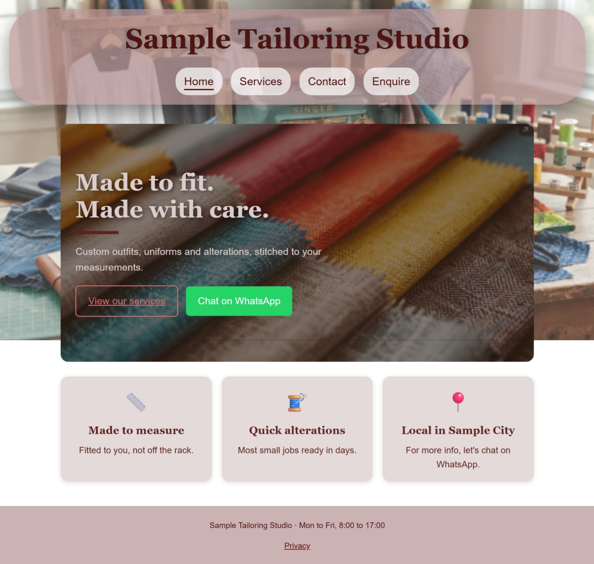
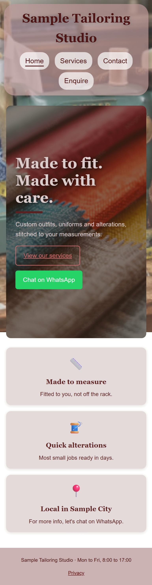

# Tailoring Business Website

A responsive website built with **Python and Flask** for a small tailoring business. It allows visitors to explore services, view completed work, and send enquiries, while providing the business owner with a private page to manage enquiries.

## Demo

**Demo video:** [Watch the website demonstration](videos/demo-video.mp4)


## Screenshots

### Desktop

<p align="center">
  
  
</p>

<p align="center">
  
  
</p>

### Mobile

<p align="center">
  
  
  
</p>


## Why I Built It

The business relies primarily on word of mouth and WhatsApp status posts to attract customers. Its services and finished work were not easily accessible in one central place, making it difficult to share a dedicated online reference with potential clients.

I built this website to make the business easier to discover and its work easier to showcase. Each piece of work can direct visitors to WhatsApp with a pre-filled enquiry message, while a QR code provides another way to share the website through printed material or digital posts.

## Features

### Visitors

- Browse the homepage and available tailoring services.
- View service details and examples of completed work.
- Contact the business through WhatsApp with a pre-filled message.
- Submit enquiries through an online form.
- View business contact information and opening hours.
- Access the website on desktop and mobile devices.

### Business owner

- Access a password-protected admin page.
- View submitted enquiries, with the newest displayed first.
- Identify where enquiries originated, such as a QR code or WhatsApp status link.

### Additional functionality

- Generate a QR code linking to the website.
- Configure business information and service content without hard-coding it into page templates.
- Health-check endpoint for deployment monitoring.

## Technologies

| Technology     | Purpose                       |
| -------------- | ----------------------------- |
| Python         | Backend programming           |
| Flask          | Web framework                 |
| Jinja          | HTML templating               |
| SQLite         | Enquiry storage               |
| HTML and CSS   | Website structure and styling |
| pytest         | Automated testing             |
| qrcode         | QR code generation            |
| PythonAnywhere | Hosting                       |

## Running Locally

### Requirements

- Python 3.12 or newer
- Git

### Installation

Clone the repository:

```bash
git clone https://github.com/sk518x/tailoring-site.git
cd tailoring-site
```

Create and activate a virtual environment on Windows PowerShell:

```powershell
py -m venv .venv
.venv\Scripts\Activate.ps1
```

Install dependencies:

```powershell
pip install -r requirements.txt
```

Set the required local environment variables:

```powershell
$env:ADMIN_PASSWORD = "choose-a-long-password"
$env:DEBUG = "1"
```

Start the application:

```powershell
py app.py
```

Open the website at:

`http://127.0.0.1:5000`

The admin page is available at:

`http://127.0.0.1:5000/admin`

## Configuration

Business details and application settings can be configured using environment variables, including:

- `ADMIN_PASSWORD`
- `SECRET_KEY`
- `BUSINESS_NAME`
- `CITY`
- `ADDRESS`
- `PHONE`
- `OPENING_HOURS`
- `WHATSAPP_NUMBER`
- `SITE_URL`
- `DEBUG`

Sensitive values and real business information are kept out of the public repository.

## Testing

The project includes more than 50 automated tests using **pytest**.

Tests cover:

- Page loading and navigation.
- Enquiry form validation and database storage.
- Admin authentication and logout.
- Security-related behaviour.
- Enquiry source tracking.
- Application configuration.

Run the tests with:

```bash
pytest
```

## Security

Security measures implemented include:

- Password-protected admin access.
- Secure session cookie settings.
- Login lockout after repeated failed attempts.
- A honeypot field to help detect automated submissions.
- Parameterised SQL queries.
- Jinja template escaping.
- Debug mode disabled by default.

## Design Decisions

- **Flask and Jinja:** Used to build a lightweight, server-rendered website.
- **SQLite:** Provides simple local database storage for enquiries.
- **WhatsApp:** Makes it easy for visitors to contact the business without building a full booking system.
- **Configuration files and environment variables:** Keep business details and sensitive settings separate from application code.

## Known Limitations

- The admin area uses a shared password rather than individual user accounts.
- Enquiries are stored in SQLite and are not encrypted at rest.
- The website does not include an online payment or booking system.
- Hosting on a free platform may involve availability and resource limitations.
- Accessibility and screen-reader testing could be expanded.

## What I Learned

Through this project, I gained practical experience in:

- Building a web application with Python and Flask.
- Connecting a web application to an SQLite database.
- Handling and validating user-submitted forms.
- Implementing authentication and basic security controls.
- Writing automated tests with pytest.
- Managing application configuration and deployment.
- Designing responsive pages for desktop and mobile devices.

## About This Project

This project was developed as a learning and portfolio project in collaboration with a real tailoring business. It was an opportunity to apply Flask, database management, testing, web security fundamentals and deployment practices to a practical business use case.

The public repository contains a demonstration version of the application. Real business details, customer information and private photographs have been excluded to protect the business's privacy.

---

*Built with Python, Flask and SQLite.*
