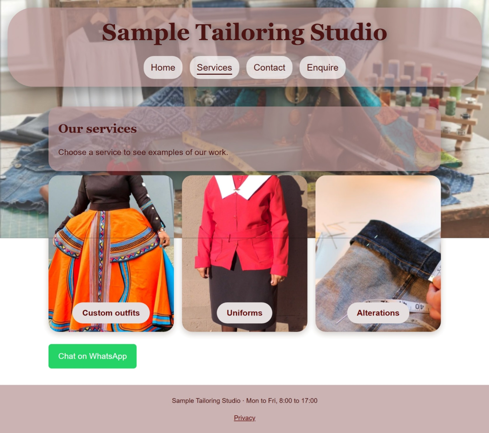
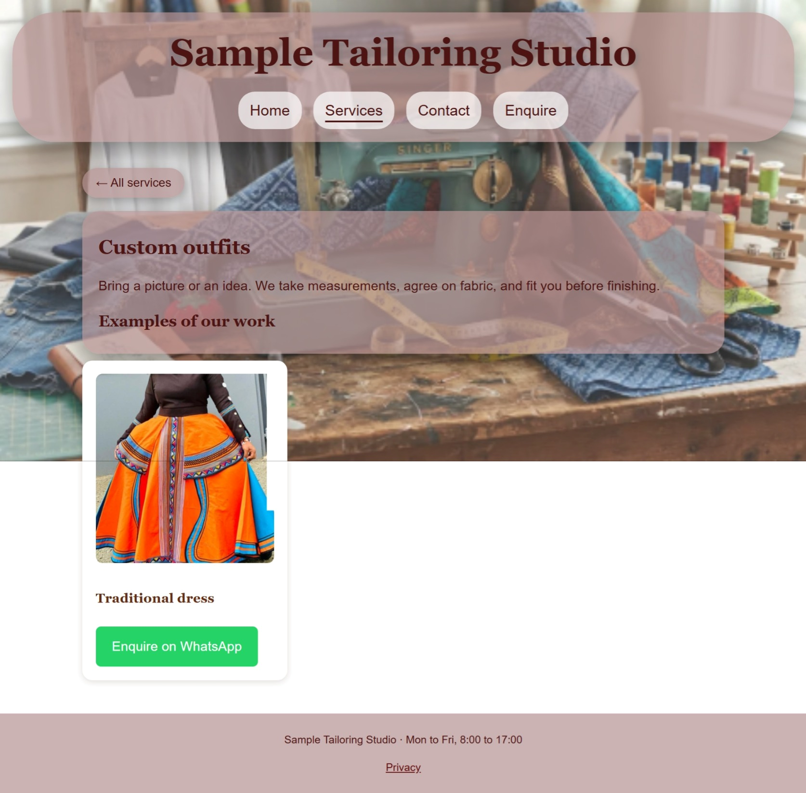
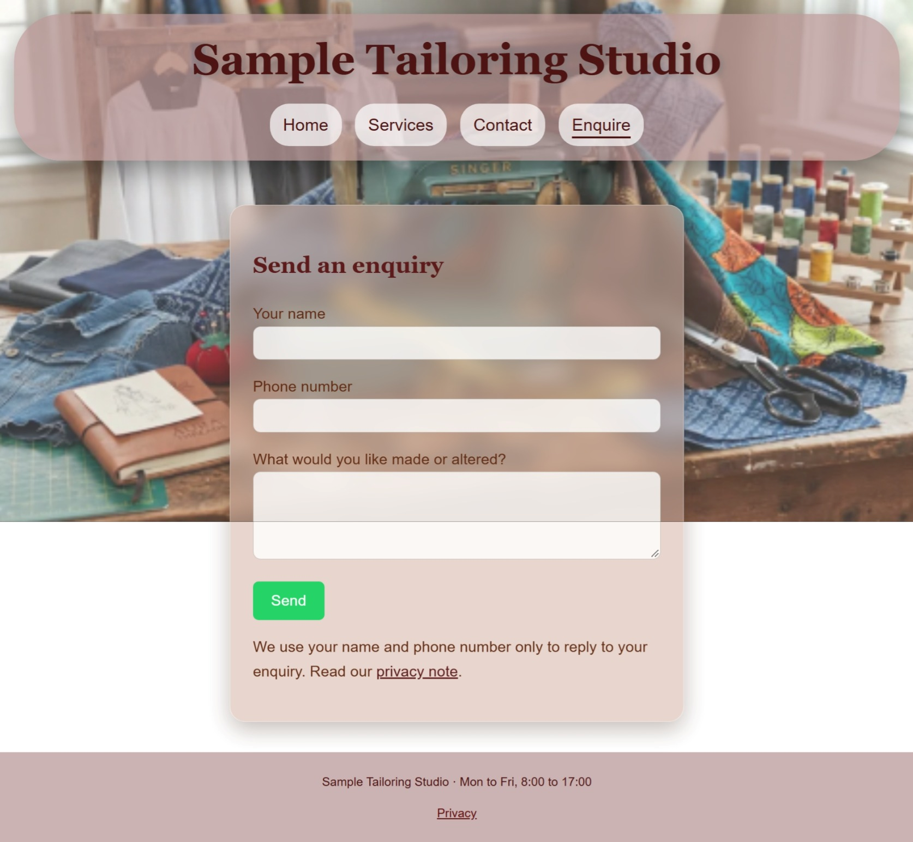
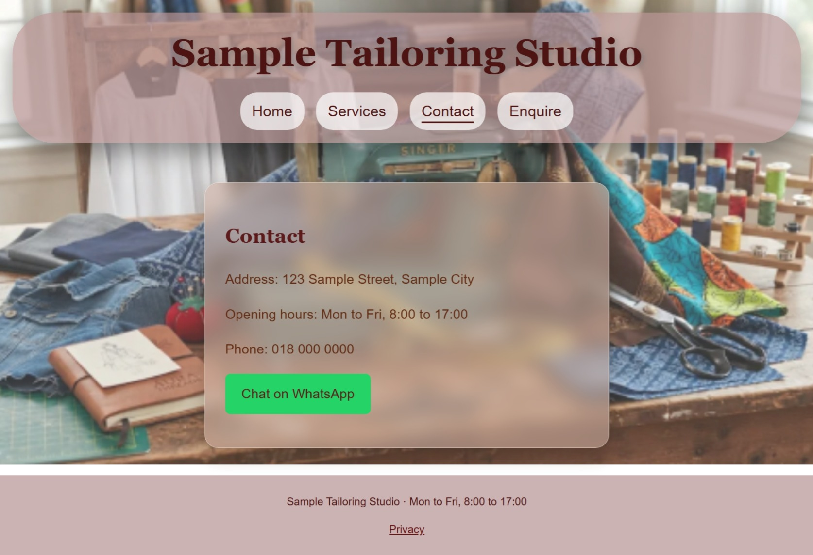
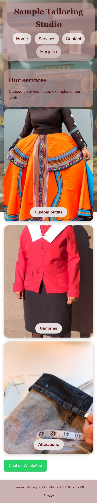
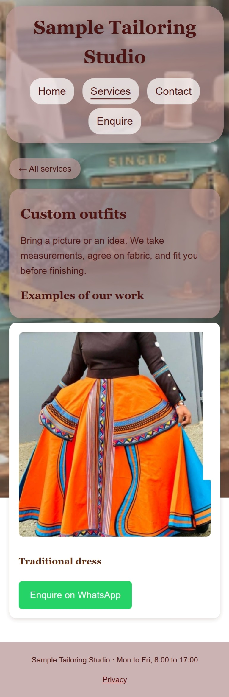

# Tailoring Business Website

A responsive showcase and enquiry website for a small tailoring and sewing business, built with Flask. Visitors can explore services and finished work, contact the owner via WhatsApp, or submit an enquiry through a web form. The owner can manage submitted enquiries through a password-protected admin page.

> **Privacy notice:** This repository contains placeholder business details, sample contact information and demo images only. The live website uses private business information and photographs stored on the server, which are not included in this repository.

---

## Overview

The project was built to give a small tailoring business an online presence where potential customers can easily view its services, browse examples of finished work and get in touch.

The website focuses on simplicity, mobile accessibility and familiar communication methods, particularly WhatsApp, rather than introducing a complicated booking or payment system.

---

## Demo

- **Video Demonstration:** [Insert demo video link here]

---

## Screenshots

The following screenshots showcase the website's main pages and functionality using placeholder content.

### Desktop View

**Homepage**


**Services Page**



**Service Details**

Visitors can explore individual services, view examples of completed work and enquire directly through WhatsApp.



**Enquiry Form**



**Contact Page**



---

### Mobile View

The website is designed to provide a responsive browsing experience across different screen sizes, making it accessible to customers using mobile devices.

**Mobile Homepage**


**Mobile Services**



**Mobile Service Details**



> All screenshots use the demonstration version of the website. No real client photographs or private business information are included.

---

## Why I Built It

The business relies primarily on word of mouth and WhatsApp status posts to attract customers. Its services and finished work were not easily accessible in one central place, making it difficult to share a dedicated online reference with potential clients.

I built this website to make the business easier to discover and its work easier to showcase. Each piece of work can direct visitors to WhatsApp with a pre-filled enquiry message, while a QR code provides another way to share the website through printed material or digital posts.

---

## Features

### Visitor Features

- **Homepage:** Introduces the business and highlights its services.
- **Services page:** Displays services using photo cards.
- **Service detail pages:** Provide descriptions and photographs of finished work.
- **WhatsApp enquiries:** Opens a WhatsApp conversation with a pre-filled message referencing the selected piece.
- **Enquiry form:** Allows visitors to submit their name, phone number and message.
- **Privacy note:** Provides information about how submitted enquiries are handled.
- **Contact page:** Displays business contact information, address and opening hours.
- **Responsive design:** Designed to work across mobile devices and desktop screens.

### Owner Features

- **Protected admin page:** Allows the owner to view submitted enquiries after authentication.
- **Enquiry management:** Displays enquiries with the newest submissions first.
- **Source tracking:** Records source tags such as `status` and `qr` to identify how visitors accessed the website.
- **QR code:** Available at `/qr.png`, linking visitors to the website with source tracking.

### Developer Features

- **Configurable business details:** Business information, services and photographs can be configured without modifying the page templates.
- **Placeholder configuration:** The application can run as a public demonstration without exposing real business information.
- **Health endpoint:** A `/health` route is available for uptime monitoring.
- **Automated testing:** Includes more than 50 tests covering application functionality, configuration and security-related behaviour.

---

## Technologies Used

| Technology | Purpose |
|---|---|
| Python | Application logic |
| Flask | Web framework |
| Jinja | Server-side HTML rendering |
| SQLite | Enquiry storage |
| pytest | Automated testing |
| HTML & CSS | Website structure and styling |
| qrcode | QR code generation |
| PythonAnywhere | Hosting and deployment |

---

## Getting Started

### Prerequisites

- Python 3.12 or newer
- Git

### Installation

Clone the repository:

```powershell
git clone <this-repo-url>
cd tailoring-site
```

Create and activate a virtual environment:

```powershell
py -m venv .venv
.venv\Scripts\Activate.ps1
```

Install the dependencies:

```powershell
pip install -r requirements.txt
```

Configure the environment variables:

```powershell
$env:ADMIN_PASSWORD = "choose-a-long-password"
$env:DEBUG = "1"
```

Run the application:

```powershell
py app.py
```

Open the website in your browser:

http://127.0.0.1:5000

The admin page is available at:

http://127.0.0.1:5000/admin

### macOS and Linux

The setup commands differ slightly on macOS and Linux:

```bash
python3 -m venv .venv
source .venv/bin/activate
pip install -r requirements.txt

export ADMIN_PASSWORD="choose-a-long-password"
export DEBUG=1

python3 app.py
```

Environment variables configured in the terminal apply to that terminal session and are not automatically saved to project files.

---

## Configuration

The application supports configuration through environment variables and an optional private `local_settings.py` file.

| Variable | Description |
|---|---|
| `ADMIN_PASSWORD` | Password used to authenticate access to the admin page. An empty password prevents login. |
| `SECRET_KEY` | Secret used to sign session cookies. A strong, random value should be configured in production. |
| `BUSINESS_NAME` | Business name displayed on the website. |
| `CITY` | Business location. |
| `ADDRESS` | Business address. |
| `PHONE` | Business contact number. |
| `OPENING_HOURS` | Business operating hours. |
| `WHATSAPP_NUMBER` | WhatsApp number in international format without `+` or spaces, for example `27712345678`. |
| `SITE_URL` | Website URL used when generating the QR code. |
| `DEBUG` | Enables debug mode when set to `1`. Disabled by default. |
| `USE_LOCAL_SETTINGS` | Enables loading configuration from `local_settings.py` when set to `1`. |

The application uses placeholder data when private business configuration is unavailable.

---

## Testing

Run the automated test suite using pytest:

```powershell
py -m pytest
```

The project contains more than 50 automated tests covering:

- Page rendering and navigation.
- Enquiry form validation and submission.
- Rejecting enquiries with invalid or empty names.
- Database operations using temporary databases.
- Admin authentication, logout and access control.
- Enquiry source tracking and sanitisation.
- Session cookie security settings.
- POST-only logout behaviour.
- Login lockout after repeated failed attempts.
- Honeypot spam detection.
- Default configuration and environment-based settings.
- Fallback behaviour when private configuration is unavailable.

Most of the tests were written before the corresponding implementation, using a test-first approach.

> Automated tests cover application behaviour and selected security controls. Visual appearance, accessibility and usability are not fully covered by the test suite.

---

## Project Structure

```text
tailoring-site/
│
├── app.py                 # Flask routes and application logic
├── database.py            # SQLite database operations
├── settings.py            # Configuration and business settings
├── templates/              # Jinja templates
├── static/
│   ├── css/                # Stylesheets
│   └── images/             # Placeholder images
├── tests/                  # Automated tests
├── screenshots/            # Desktop and mobile screenshots
├── requirements.txt        # Python dependencies
└── README.md
```

---

## Deployment

The live website is hosted on PythonAnywhere.

The deployment process and configuration are separated from the public repository to protect private business information.

- The deployed application is updated using Git.
- Real business details and secrets are configured on the server.
- Real photographs and private service descriptions are excluded from the repository.
- `local_settings.py` and private photo files are listed in `.gitignore`.
- The server uses its WSGI configuration for deployment settings.
- An uptime monitor checks the `/health` endpoint.

---

## Design Decisions

### WhatsApp Instead of a Booking System

WhatsApp was chosen because it is already the primary communication method used by the business and its customers.

Rather than introducing account registration, online payments or a complex booking workflow, the website makes it easy for visitors to start a conversation directly with the owner.

### Configuration Instead of Hard-Coded Business Details

Business details, services and photographs are separated from the templates.

This allows the application to use different business configurations without changing the underlying application code, making it easier to maintain and reuse.

### Environment Variables for Secrets

Passwords and secret keys are configured outside the source code.

This reduces the risk of accidentally exposing sensitive configuration in the public repository and supports a clearer separation between development and production environments.

### Private Business Data

Real business photographs and configuration files are excluded from GitHub through `.gitignore`.

The application falls back to placeholder content when private configuration is unavailable, allowing the public repository to remain a demonstration of the application without exposing the real business's information.

### SQLite

SQLite was selected because it provides a lightweight database solution without requiring a separate database server.

It is sufficient for the expected scale of this project, although it may not be the ideal choice for applications requiring high concurrency or more complex database infrastructure.

### Server-Rendered Pages

Flask and Jinja were used to render pages on the server.

This approach keeps the application relatively simple, reduces the need for additional frontend infrastructure and makes the website easier to maintain.

---

## Security

The application includes several security-related measures:

- Admin access requires password authentication.
- An empty admin password cannot be used to authenticate.
- Session cookies use `HttpOnly`, `SameSite=Lax` and `Secure` settings, with the secure cookie setting adjusted for local debug mode.
- Logout requires a POST request.
- Login attempts are temporarily locked after five incorrect passwords from the same reported address.
- The enquiry form includes a honeypot field to help detect automated spam.
- SQL queries use parameterised statements.
- Jinja template rendering provides automatic HTML escaping for template output.
- Source tracking tags are sanitised and limited to 20 characters.
- Debug mode is disabled by default.

These measures help reduce common risks, but they do not guarantee that the application is free from security vulnerabilities.

---

## Known Limitations

- Admin access uses a single shared password rather than individual user accounts.
- Login lockout data is stored in memory and resets when the application restarts.
- The lockout mechanism relies on the address reported by the hosting environment and has not been tested against all possible proxy or header manipulation scenarios.
- The honeypot field provides basic spam protection and does not prevent sophisticated automated submissions.
- Source tracking is limited to the browser session.
- Services and photographs must be updated through configuration files on the server rather than an admin content management system.
- Enquiry data, including names and phone numbers, is stored unencrypted in SQLite.
- The hosting plan has resource limitations and manual renewal requirements.
- The website uses Google Fonts, which means visitors' browsers may make requests to Google.
- Accessibility testing, screen-reader testing and comprehensive colour-contrast testing have not been completed.
- The privacy note is not legal advice. A business using the website in South Africa should review its privacy practices against applicable POPIA requirements and guidance from the Information Regulator.

---

## What I Learned

- Writing tests before implementation helped clarify expected behaviour and identify errors earlier during development.
- Protecting secrets and personal information requires planning from the beginning, especially when working with Git and public repositories.
- Deploying an application introduced practical differences between local development and production environments, including environment configuration, secure cookies and file management.
- Debugging became more effective when I focused on the underlying error rather than only the first message displayed.
- Building for a real-world use case requires balancing functionality, simplicity, security and the actual needs of the people using the application.

---

## About This Project

This project was developed as a learning and portfolio project to apply Flask, database management, testing, web security fundamentals and deployment practices to a practical business use case.

The repository contains a demonstration version of the application and does not expose the real business's private information or photographs.

---

*Built with Python, Flask and SQLite.*
